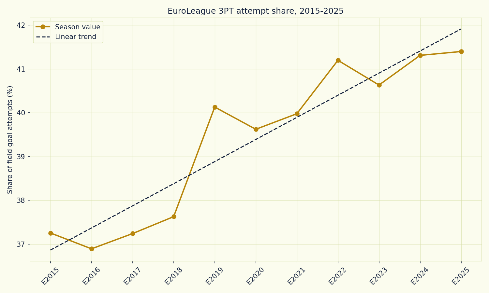
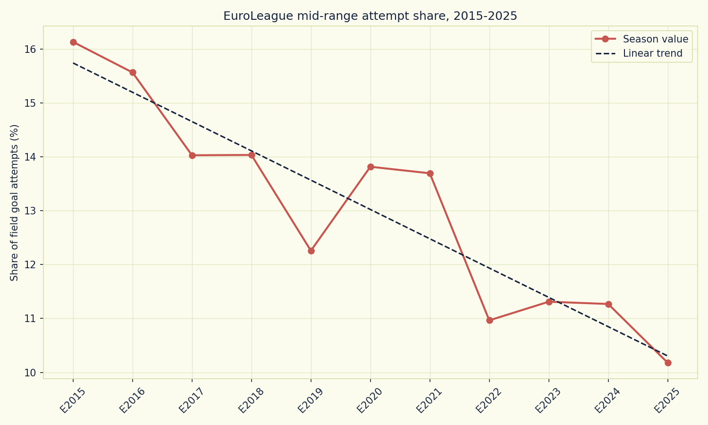

# EuroLeague shot selection, 2015-2025

A league-wide analysis of EuroLeague field goal attempts, classified by zone (paint, mid-range, three-point) from shot coordinates. It tests whether the league has moved away from the mid-range toward the three-point line, as the NBA did in the "Moreyball" years, and whether shot value (eFG%) explains the shift.

**Brief report:** [open the report](https://htmlpreview.github.io/?https://github.com/viare21/euroleague-shot-efficiency/blob/main/shot_efficiency_report.html)

## Results in brief

1. Once the extra point is counted, a three-pointer is worth 55.0% eFG against 38.3% for a mid-range shot. The paint is at 57.8%. Raw FG% hides this: 36.6% for threes against 38.3% for mid-range.
2. The mid-range share of attempts fell from 16.1% (E2015) to 10.2% (E2025), a trend of -0.54 percentage points per season.
3. The three-point share rose from 37.3% to 41.4%, a trend of +0.50 points per season. The paint share stayed around 46-49%.

## Data

Source: [Euroleague & Eurocup Datasets](https://www.kaggle.com/datasets/babissamothrakis/euroleague-datasets) (Kaggle). Seasons `E2015` to `E2025` (2015-16 to 2025-26). The file holds 407,351 field goal attempts in this range (free throws excluded). 406,940 are used after dropping shots with placeholder coordinates.

| File | Columns used |
|---|---|
| `euroleague_points.csv` | `season_code`, `action_id`, `points`, `coord_x`, `coord_y` |

Coordinates are in centimeters, measured from the basket.

## Project structure

| File | Role |
|---|---|
| `euroleague_shot_efficiency.py` | Main script: classifies shots, computes shares and efficiency, saves the two trend charts |
| `images/` | Output charts (created by the script if missing) |
| `shot_efficiency_report.html` | Brief report with the narrative and the findings |

The data file is not included in the repository. It is read from a `csv_euroleague` folder placed next to the project folder.

## How it works

The script is organised in numbered sections, run top to bottom.

1. **Paths and load (0, 1).** Paths are relative to the script. The shot file is loaded and filtered on `E2015`-`E2025`.
2. **Field goal dataset (2).**
   - Free throws (`action_id == 'FTM'`) are excluded. Only makes are logged for them, with no matching attempt code, so attempts cannot be counted.
   - **Shot type** comes from `action_id`: codes starting with `2` are two-pointers, codes starting with `3` are three-pointers. `LAYUPATT`, `LAYUPMD` and `DUNK` have no numeric prefix and are always two-pointers.
   - **Made or missed** comes from `points > 0`, not from parsing the action code, because the codes are varied (`2FGM`, `3FGA`, `LAYUPATT`, `DUNK`, `3FGAB`, and others).
   - **Zone.** Three-point attempts are tagged `3PT`. A two-point attempt is `Paint` if it falls inside the FIBA key, otherwise `Mid-range`. The key is the rectangle `|coord_x| <= 245` and `-157.5 <= coord_y <= 422.5` (4.9 m wide, 5.8 m long, starting at the baseline, 157.5 cm behind the basket). This is the same rule used in the Olympiacos project.
3. **Data quality checks (2.1).** Three checks on the classification, described in the next section. Shots with placeholder coordinates are dropped at this point.
4. **League summary (3).** Attempts, makes, share of attempts and FG% by zone.
5. **Shot selection by season (4).** Share of attempts by zone, per season.
6. **FG% by zone and season (5).**
7. **eFG% (6).**

   `eFG% = (FGM + 0.5 * 3PM) / FGA`

   For two-point zones eFG% equals FG%. For the three-point zone it is FG% times 1.5. The league-wide figures in the results are the mean of the 11 season values. The script also prints the pooled rates over all attempts, which differ by 0.1 points at most (paint 57.9%, mid-range 38.3%, 3PT 36.6%).
8. **Trend charts (7, 8).** One line per zone share, with a least squares linear fit (`np.polyfit`, degree 1) over the 11 seasons. The slope is printed as percentage points per season.

### Design choices

- The zone is derived from coordinates instead of using the zone labels in the data, to keep the rule explicit and identical across projects.
- Only two-point shots are split by location. Three-pointers are not split into corner and above the break.
- eFG% is used instead of FG% because zones with different point values cannot be compared on raw percentage.

## Data quality checks

The shot type (2PT or 3PT) comes from `action_id` and the paint/mid-range split from coordinates, so the checks test the two sources against each other. Results on the full range:

| Check | Result |
|---|---|
| Shots with an unrecognised `action_id` | 0 |
| Missing (NaN) coordinates | 0 |
| Placeholder coordinates (0, 0) | 411 shots (0.10%): 401 two-pointers and 10 three-pointers. They are dropped |
| Median distance from the basket | 3PT 727 cm, 2PT 180 cm |
| Three-pointers closer than 600 cm | 182 (0.11% of 3PT) |
| Two-pointers farther than 700 cm | 227 (0.09% of 2PT) |

A shot at (0, 0) would sit under the basket, which is where a missing coordinate is stored, so these shots cannot be placed on the court. Without the drop, the 401 two-pointers would all be tagged as paint.

The distance thresholds follow the geometry of the court: the three-point line is 660 cm from the basket in the corners and 675 cm at the top. Fewer than 0.2% of shots fall on the wrong side of the line, which is consistent with small coordinate errors and with shots taken near the line, so the classification is reliable for this analysis. The shots are not removed.

The earlier version of this README stated that the coordinate rule agreed with the shot type on 100% of shots. That comparison could not fail, since the three-point zone is taken from the shot type, so the statement was replaced by the distance check above.

## Outputs

`images/three_pt_share_trend.png`: season share of three-point attempts with linear trend.

`images/mid_range_share_trend.png`: season share of mid-range attempts with linear trend.

League-wide shot value, mean of the 11 season values:

| Zone | FG% | eFG% |
|---|---|---|
| Paint | 57.8% | 57.8% |
| Mid-range | 38.3% | 38.3% |
| 3PT | 36.6% | 55.0% |

Share of attempts, selected seasons:

| Season | Paint | Mid-range | 3PT |
|---|---|---|---|
| E2015 | 46.6% | 16.1% | 37.3% |
| E2018 | 48.3% | 14.0% | 37.6% |
| E2021 | 46.3% | 13.7% | 40.0% |
| E2025 | 48.4% | 10.2% | 41.4% |

## How to run

1. Download the dataset from Kaggle and place `euroleague_points.csv` in a folder named `csv_euroleague`, one level above this project's folder.
2. Install the requirements: `pip install pandas numpy matplotlib`
3. Run `euroleague_shot_efficiency.py`.

In Spyder, press F5 to run the whole file. Running cell by cell (F9) also works: if `__file__` is not defined, the script falls back to the current working directory, so set it to the project folder first.

## Limitations and possible extensions

- The analysis is descriptive. It shows that the mid-range share fell and that mid-range is the lowest value zone, not why teams changed their shot selection.
- eFG% is an average over all attempts in a zone. It does not account for defensive pressure, shot clock or shooter quality, so a low mid-range eFG% may partly reflect who takes those shots and when.
- The league averages are a mean of seasons, so each season weighs the same whatever its number of shots. Pooled rates give the same picture.
- The linear trend is a summary over 11 points. It does not show whether the change was gradual or concentrated in a few seasons.
- It could be extended by splitting the three-point zone into corner and above the break, and by looking at which teams drove the shift.
