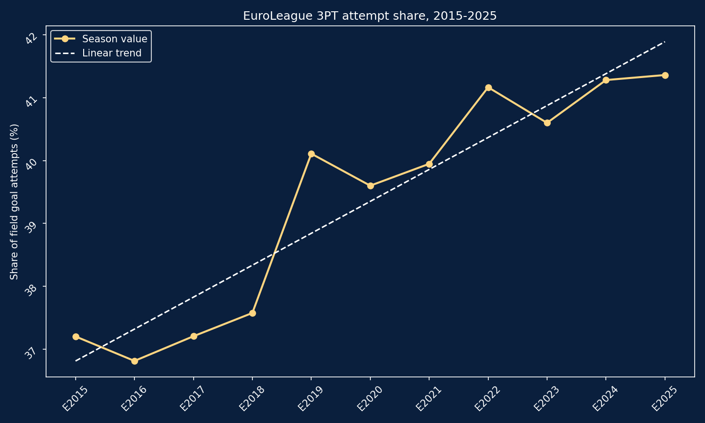
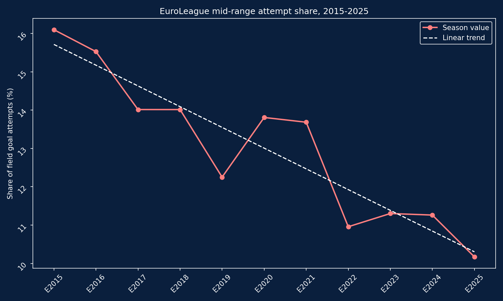

# The Moreyball Shift: How EuroLeague Shot Selection Changed, 2015-2025

A league-wide shot data analysis testing whether EuroLeague has followed the same shift the NBA made famous: trading mid-range jumpers for 3-point attempts, and why the math behind that shift makes sense even when raw shooting percentages look similar.

## Background

Over the past decade, NBA teams have moved away from mid-range shots in favor of shots at the rim and from beyond the arc, a shift often nicknamed "Moreyball" after Daryl Morey, the executive who pushed it hardest with the Houston Rockets. The logic isn't that mid-range shots are hard to guard, it's that they're a poor value: a well-defended 3-point attempt is often worth more, on average, than an open mid-range jumper.

This project asks whether EuroLeague has followed the same path, using shot-level data across 11 seasons: **has the league moved away from the mid-range, and does the underlying shot value actually explain why?**

## Data & Tools

- **Data source:** [Euroleague & Eurocup Datasets](https://www.kaggle.com/datasets/babissamothrakis/euroleague-datasets) (Kaggle), specifically `euroleague_points.csv` (shot-level data with court coordinates for every field goal attempt)
- **Tools:** Python, pandas, numpy, matplotlib
- **Scope:** 499,235 shot attempts, seasons 2015-16 through 2025-26 (`E2015`-`E2025`)

## Methodology

### Deriving shot zones from court coordinates

Shot zones are derived directly from shot coordinates (in centimeters, measured from the basket), rather than relying on the zone labels already present in the data, to keep the classification transparent and consistent with the same method used in a related Olympiacos shot analysis project. Any 2-point attempt taken inside the FIBA key (the painted area under the basket, sometimes called the three-second area) is tagged **Paint**, everything outside it **Mid-range**. 3-point attempts are identified directly from the shot type.

This coordinate-based classification was cross-checked against the shot type recorded in `action_id` (2PT vs 3PT): the two methods agreed on **100%** of shots, confirming the zone logic is reliable for this dataset.

Made/missed is derived from the `points` column (points scored on that specific attempt) rather than parsing shot-type text, which proved more reliable given how varied the action codes are (`LAYUPATT`, `DUNK`, `3FGAB`, and others alongside the more standard `2FGM`/`3FGA`). Free throws (`FTM`) are excluded entirely: only makes are logged, with no matching attempt code, so they can't be reliably counted as attempts.

### Why effective field goal percentage (eFG%)

Comparing raw shooting percentages across zones might be misleading, since a 3-point make is worth more than a 2-point make. Effective field goal percentage corrects for this:

```
eFG% = (FGM + 0.5 x 3PM) / FGA
```

For 2-point zones (Paint, Mid-range), eFG% is identical to plain FG%. For 3-point attempts, eFG% is FG% multiplied by 1.5, since a made 3 is worth 1.5x a made 2. This is a standard way analysts compare shot value across zones.

## Results

### Shot value: FG% vs eFG%, by zone (league-wide average, 2015-2025)

| Zone | FG% | eFG% |
|---|---|---|
| Paint | 57.8% | 57.8% |
| 3PT | 36.6% | **55.0%** |
| Mid-range | 38.3% | 38.3% |

This is the core finding. Looking at raw FG%, mid-range (38.3%) actually looks slightly better than 3-point shooting (36.6%), which might suggest mid-range is the more efficient shot. But once the extra point is accounted for, 3-point attempts are worth **55.0% effectively**, nearly as valuable as a shot in the paint, and clearly ahead of the mid-range's 38.3%. The mid-range isn't a marginally worse shot, it's the worst value on the floor by a wide margin, even though it doesn't look that way in raw shooting percentage.

### Shot selection trend, 2015-2025





| Season | Paint | Mid-range | 3PT |
|---|---|---|---|
| E2015 | 46.7% | 16.1% | 37.2% |
| E2018 | 48.4% | 14.0% | 37.6% |
| E2021 | 46.4% | 13.7% | 39.9% |
| E2025 | 48.5% | 10.2% | **41.4%** |

- **3PT share trend: +0.51 percentage points per season** (linear fit across all 11 seasons)
- **Mid-range share trend: -0.54 percentage points per season**

The two trends mirror each other almost exactly. Mid-range attempts have nearly been cut in half (16.1% to 10.2% of all shots), while 3-point attempts have grown steadily (37.2% to 41.4%). Paint attempts have stayed roughly flat throughout, hovering around 47-48%. The shift isn't away from 2-point shots in general, it's specifically away from the low-value mid-range jumper, exactly the pattern the eFG% numbers above would predict.

## Takeaways

- EuroLeague has followed the same directional shift as the NBA's "Moreyball" movement: a steady, decade-long move away from mid-range shots and toward the 3-point line.
- Raw shooting percentages alone don't explain this shift; mid-range and 3-point FG% look similar. Effective field goal percentage does: 3-point shots are worth roughly as much as shots in the paint once the extra point is factored in, while mid-range shots are clearly the least valuable shot on the floor.
- The trend is consistent and gradual (roughly half a percentage point per season in both directions), not a sudden overhaul, suggesting an incremental, league-wide shift in shot selection philosophy rather than a handful of teams driving the numbers.
- Paint attempts have remained the single largest share of shots throughout the period, unaffected by the mid-range to 3-point shift.

## How to Reproduce

1. Download the [Euroleague & Eurocup Datasets](https://www.kaggle.com/datasets/babissamothrakis/euroleague-datasets) from Kaggle
2. Place `euroleague_points.csv` in a `csv_euroleague` folder, one level above this project's folder
3. Run the analysis script (requires `pandas`, `numpy`, `matplotlib`)

## About

This project combines a background in basketball coaching (8 years, youth and regional level) with data analysis.
